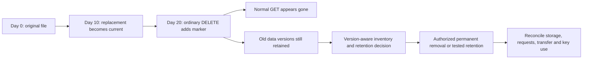

# A deleted file can still occupy the shelf

Maya keeps a customer's design file in a private S3 bucket. On day 10 she replaces it. On day 20 the customer asks her to remove it. The app sends an ordinary delete, and a normal read now returns “not found.” Maya's cleanup checklist says the file is gone. That conclusion is unsafe if bucket versioning is enabled: S3 makes a **delete marker** the current version while earlier data versions can remain stored. They can still cost money and may still be recoverable by an authorized version-specific read. [AWS versioning](https://docs.aws.amazon.com/AmazonS3/latest/userguide/Versioning.html), [deleting versions](https://docs.aws.amazon.com/AmazonS3/latest/userguide/DeletingObjectVersions.html).

This offline lesson makes the reader follow four separate questions: **Who can read which version? What bytes remain? Which requests and transfers occur? What proves cleanup?** It extends the [dated Ohio upload-and-delete lab](../ohio-upload-delete/README.md), which intentionally had no reads, versioning, KMS or transfer. Start with the invented cost units (CU) to learn the shape, then use the separately dated public-price extension below. Neither is an account bill or a whole-run estimate. The scripts call no AWS account service.



The arrow to permanent removal is a **decision**, not an instruction to erase a real customer's data. A valid retention rule, legal hold, backup promise or recovery requirement may require keeping a version. Document that requirement first. S3 Lifecycle current-version expiration alone does not delete noncurrent versions; `NoncurrentVersionExpiration` addresses those versions separately. Lifecycle acts asynchronously, so a rule's presence is not a receipt that every version is already gone. [AWS lifecycle expiration](https://docs.aws.amazon.com/AmazonS3/latest/userguide/lifecycle-expire-general-considerations.html).

## Work the customer path before the bill

The example assumes one object key. Its original data version is 4 MiB, the replacement is 6 MiB, and the model looks through day 30. Forty successful 6 MiB downloads happened **before** the day-20 marker. The worksheet compares keeping both data versions through day 30 with a separately authorized scenario that removes the old version on day 20. Both scenarios keep the replacement through day 30. This is a simplified billing-shape comparison, not a claim that a real lifecycle rule executes at an exact hour.

Ask who made the requests. The app role should read only the intended customer's object and, if needed, only the intended version; a customer's knowledge of a key or version ID is not authorization. Restrict the bucket and IAM policies, retain Block Public Access, use TLS, and test both an allowed request and an unrelated customer's denied request before claiming isolation. S3's default new-object encryption is SSE-S3. If a customer-managed SSE-KMS key is required, review both S3 and KMS permissions: uploads need `kms:GenerateDataKey`, downloads need `kms:Decrypt`, and the key must be in the bucket's Region. KMS has separate key and request charges. [S3 security](https://docs.aws.amazon.com/AmazonS3/latest/userguide/security-best-practices.html), [SSE-KMS permissions](https://docs.aws.amazon.com/AmazonS3/latest/userguide/UsingKMSEncryption.html), [KMS pricing](https://aws.amazon.com/kms/pricing/).

Do not guess KMS requests by multiplying GETs. S3 Bucket Keys can reduce KMS calls, but the effect depends on requesters and request patterns, and a bucket key changes the KMS encryption context from the object ARN to the bucket ARN. Existing objects do not acquire a bucket key merely because the bucket setting changes. That is a security-design and cost question, not a free toggle. [AWS Bucket Keys](https://docs.aws.amazon.com/AmazonS3/latest/userguide/bucket-key.html).

## Run the local worksheet

From the repository root:

```sh
python3 examples/storage-cost/versioned-read-path/lab.py
python3 examples/storage-cost/versioned-read-path/priced_lab.py
python3 -m unittest discover -s examples/storage-cost/versioned-read-path -p 'test_*.py' -v
```

The first script counts each data version's **byte-days** separately, then prints storage, PUT, GET and transfer components using invented CU rates. It deliberately leaves KMS counts unknown unless supplied as observations. Even when those counts are supplied, `approved_to_deploy` remains false: a local subtotal cannot prove real regional rates, Free plan applicability, a whole-run forecast or cleanup. It excludes delete-marker storage, minimum-duration terms for other classes, failed/retried requests, multipart effects, access logs, replication, inventory, application compute, taxes and other selected features.

### Put a dated price beside the same customer story

The second script uses a [saved public-price snapshot](public-prices.json) from the AWS S3 and AWS Data Transfer Ohio offer files, checked October 21, 2026 UTC. It selects S3 Standard first-tier storage at USD 0.023 per binary GB-month, PUT at USD 0.000005 per request, GET at USD 0.0000004 per request, and Ohio internet outbound transfer's first tier at USD 0.09 per GB. The source URLs, SHA-256 hashes, publication dates, SKUs, usage types and units are in that JSON. Run `python3 examples/storage-cost/versioned-read-path/refresh_prices.py` to check whether both public offer files still match; a mismatch requires human review before updating with `--write`. AWS says S3 storage GB is 2³⁰ bytes. The worksheet uses that binary divisor for its small-file calculation. [S3 pricing](https://aws.amazon.com/s3/pricing/).

| Fictional 30-day path | Stored version byte-days | Selected gross subtotal before allowances or credits |
| --- | ---: | ---: |
| Both data versions retained | 240 MiB-days | USD 0.0212994375 |
| Old version removed on day 20 with authorization | 200 MiB-days | USD 0.0212694896 |

The gap is about **USD 0.00002995** in this tiny example. Forty 6-MiB internet downloads contribute **USD 0.02109375** at the selected gross transfer rate in *either* scenario. This does not mean that removing a version is unimportant: the privacy and recovery promise may dominate a few thousandths of a cent. It also does not mean the account will pay this transfer amount. AWS currently describes a shared first 100 GB per-month internet outbound allowance across eligible AWS services and Regions, but the selected account's available allowance is unknown here. Pricing the selected traffic at the first paid tier deliberately avoids claiming that allowance or trial credits. The internet route must be verified; same-Region AWS consumers and CloudFront have different S3 transfer treatment. [S3 data-transfer pricing](https://aws.amazon.com/s3/pricing/).

The gross subtotal is **not** an upper bound or deployment authorization: it omits marker bytes, KMS if selected, retries, proof reads, logging, application compute, other retained copies and taxes. It also assumes the fictional 30-day byte-day model and first price tiers; actual AWS metering and account aggregation can differ. A full proposal must use the selected workload's meter list, current [S3 pricing](https://aws.amazon.com/s3/pricing/), actual Free plan/credit facts and cleanup plan.

### Connect the recovery inventory to the cost worksheet

The [integrated recovery lab](../../integrated-restore/README.md#ask-a-versioned-s3-api-for-the-photo) creates two data versions behind a delete marker and stages a confirmed copy under a new key. Its emulated version listing supplies **23, 24 and 23 bytes** for those three data versions. The [bridge script](emulated_restore_bridge.py) carries those observed fixture sizes into this dated price worksheet, but supplies **30-day lifetimes, three PUTs, two GETs and zero internet-transfer bytes as declared assumptions**. Run it with the pinned Moto environment:

```sh
.venv-labs/bin/python examples/storage-cost/versioned-read-path/emulated_restore_bridge.py
.venv-labs/bin/python -m unittest discover -s examples/storage-cost/versioned-read-path -p 'moto_restore_bridge_tests.py' -v
```

The bridge compares keeping the confirmed original through day 30 with removing it on day 20 **after** staging the recovery candidate. That second path has a different recovery promise: the original version ID no longer works, even though the separate candidate remains. The tiny selected subtotal is dominated by the assumed request line, so extrapolating it to a real photo collection would be misleading. Version listings, marker bytes, bucket setup, deletions, internet delivery, KMS, retries, logs and other services are outside it. The price snapshot was rechecked against the public offer files on October 21; it is still not the account's Free-plan balance, credit applicability or bill. Neither result authorizes deployment. Ask Codex to label each quantity **observed in Moto**, **assumed for the model** or **unknown in AWS** before it recommends any cleanup. [AWS Versioning](https://docs.aws.amazon.com/AmazonS3/latest/userguide/Versioning.html), [S3 pricing](https://aws.amazon.com/s3/pricing/).

Before reading the program's result, predict which scenario has more retained byte-days. Then change one fact: the customer asks to download the prior version *after* the marker, or requires every copy to be removed within 24 hours. Explain how access policy, retention, proof and the meter list change. A correct subtotal is not enough if the promised action cannot be authorized or verified. Compare your written attempt with the [assessor reasoning](ASSESSOR.md) afterward.

For a future live lab, write the exact Region, role, bucket/key scope, test objects, current public prices, credit eligibility and expiration, expected requests/bytes/key operations, failure allowance and cleanup plan into a reviewed whole-run estimate. Choose a spending limit and protected reserve for **your own account** before deciding whether to run it. This local exercise does not establish any account's live balance or resource state. Organization-dependent sharing remains design-only in this project.

Ask Codex: “For this customer's delete request, list every data version, marker, permission boundary and cost meter. What evidence would show the old version was retained or removed? Which numbers are observations, which are assumptions, and which cannot be inferred from GET count?” Compare its answer with the AWS sources and the script's explicit inputs. An AI answer is a review aid, not proof of authorization, billing or cleanup.
