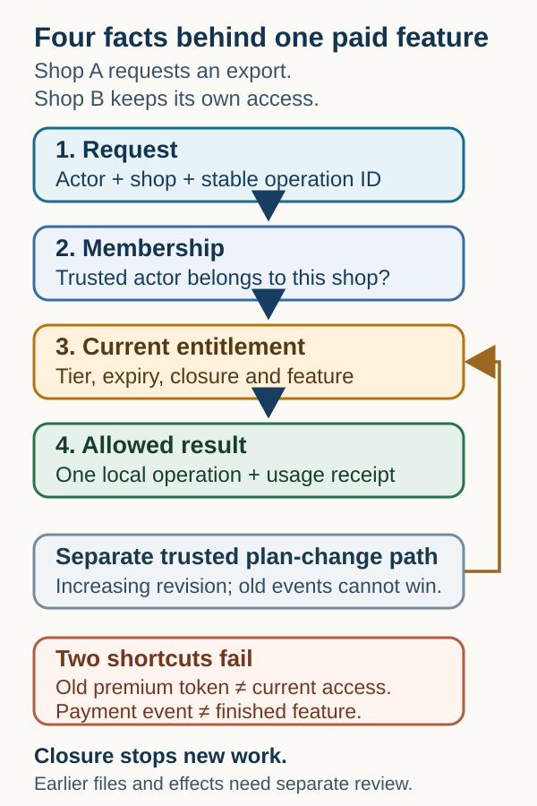

# A paid feature is a current permission, not a badge from last week

Shop A buys the premium export feature. Alice signs in on Monday and her browser receives a token while the shop is premium. On Wednesday the trial expires. The browser still has Monday's page open. If the server trusts the old label alone, Alice can export after the shop's right to that feature has ended. Shop B's premium subscription must keep working throughout.

An **entitlement** is the application's current rule for what a tenant may do. It is separate from *identity* (who Alice is), *membership* (which shop Alice may act for), *isolation* (which shop's data may be touched), and *billing evidence* (what the provider or business recorded). The picture gives each decision its own stop point.



## Make the promise observable

For this fictional portal, any active standard or premium shop may read its own note. Only an active premium shop may start a premium export. A shop's access expires at its stated time unless a trusted, newer plan decision extends it. A closed shop starts no new work. The same operation ID can return its earlier local receipt without creating another usage row; changing the intended feature under that ID is a conflict. These are **chosen business rules for this exercise**, not universal subscription terms.

| Separate question | What the local fixture checks | What a real design must still establish |
| --- | --- | --- |
| Who is acting for which shop? | A synthetic membership row; Alice cannot claim Shop B | Authenticated identity, current membership and all API paths |
| May this shop use this feature now? | Current tier, expiry and status from SQLite | Trusted source of plan changes, time basis, revocation latency and effective authorization |
| Is this a retry? | Tenant plus operation ID identifies one local receipt | Whole customer workflow and any outside provider effect |
| What was used or owed? | Count of locally accepted operations | Usage policy, provider invoice, credits/refunds, reconciliation and customer-visible result |

The server checks membership **before** the requested tenant's data or entitlement. An old premium token can identify Alice but is not treated as the current paid-feature decision. The plan update has an increasing revision: a delayed older update cannot restore premium after a downgrade, and a repeat of the same update is harmless. A conflicting payload with the same revision needs investigation rather than an arbitrary winner.

## Try the cloud-free timeline

From the repository root:

```sh
python3 examples/tenant-entitlement/lab.py
python3 -m unittest discover -s examples/tenant-entitlement -p 'test_*.py' -v
```

The script creates two temporary SQLite tables of authority plus a tenant-scoped usage-receipt table, then removes the file. It makes no AWS call and does not contact a payment provider. Predict each result before running:

1. Alice exports before Shop A expires. At the expiry boundary, Alice attempts another export with her old premium screen still open.
2. Bob uses Shop B at the same later time. Alice supplies `shop-b` in her own request.
3. Shop A receives revision 3 changing it to standard. A delayed revision 2 says premium; revision 3 is delivered again.
4. Alice tries a new premium export, then a standard note read twice with one operation ID.
5. Shop A closes. Alice tries a new read while Shop B's earlier receipt remains.

The five focused tests add a conflicting same-revision update, a changed-intent retry and an old receipt after downgrade. The fixture checks current plan state and stores the accepted operation in one SQLite transaction. That makes a small local invariant visible; it is not a payment ledger or a distributed authorization system. If an export is an external download, a row alone cannot prove the file was generated, delivered, withdrawn or billed correctly.

## Transfer the pattern to AWS without deploying it

One candidate architecture uses Cognito for sign-in, an application API that checks trusted tenant membership, an authoritative tenant/entitlement record, and a tenant-scoped operation ledger. DynamoDB conditional writes or transactions could help enforce selected single-record or grouped state changes, but a conditional write does **not** authenticate a caller, validate a payment provider, or protect an unrelated file URL. The application must define those boundaries and test them. AWS's [Cognito multi-tenancy guidance](https://docs.aws.amazon.com/cognito/latest/developerguide/multi-tenancy-security-recommendations.html) calls for tenant-matching application authorization; its [SaaS identity guidance](https://docs.aws.amazon.com/whitepapers/latest/saas-architecture-fundamentals/saas-identity.html) explains why tenant context travels through the workload. [DynamoDB condition expressions](https://docs.aws.amazon.com/amazondynamodb/latest/developerguide/Expressions.ConditionExpressions.html) are one possible write guard, subject to the chosen key, transaction and capacity model.

A premium *feature tier* is not automatically a dedicated infrastructure tier. AWS describes pooled and siloed resources as separate isolation choices that a business might offer in different tiers. Shop A can buy an export feature while remaining in a pooled database if its access, recovery and performance promises are met; Shop B can require dedicated selected resources for a different reason. Compare the two designs against tested isolation, onboarding, selective restore, noisy-neighbor behavior, operations and the whole bill before choosing. [AWS tier-based isolation](https://docs.aws.amazon.com/whitepapers/latest/saas-tenant-isolation-strategies/tier-based-isolation.html).

If a future provider sends plan events, verify the sender and event identity, version the tenant decision, define the effective time and reconcile missed or disputed events. A webhook's arrival does not prove a payment settled, a feature was delivered or a customer saw a result. A new tier can change storage, processing, network, log, support and retained-data meters; a downgrade may leave queued premium work and previously generated exports. Decide what happens to those separately. There is no provider integration, invoice, AWS architecture or measured cost in this exercise. A cloud run needs a scoped non-root identity, current plan and credit terms, a complete estimate, account-appropriate spending and reserve limits, and reviewed cleanup. Organization-dependent isolation remains design-only unless separately authorized in a suitable environment.

**Change one fact before asking Codex.** Shop A downgrades while a premium export is already accepted but has not begun. Write two credible policies: finish accepted work or cancel it with a truthful receipt. For each, identify the actor, durable state, file and billing consequence, and an observation that would reject the design. Then ask Codex to find an access path or delayed event your answer missed. Keep your first answer and check its AWS claims against the sources and actual system before reading the [assessor notes](ASSESSOR.md).
