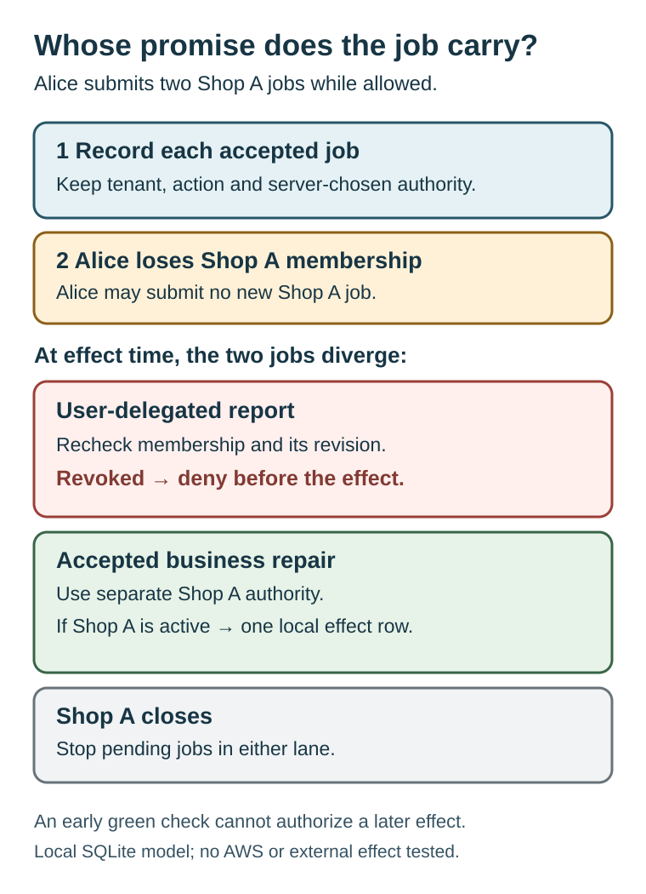
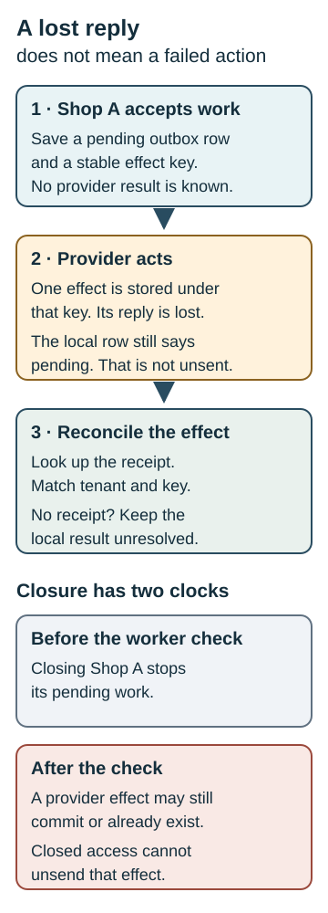

# Two businesses, the same record ID, different data

Run `python3 examples/tenant-isolation/lab.py` from the repository root. The standard-library exercise creates and removes a temporary SQLite database. There are no AWS calls.

Alice belongs to shop A and Bob to shop B. Both shops have a note named `shared-id`, with different contents. The database key and cache key include tenant plus record ID. A request-supplied tenant is checked against the synthetic identity lookup; it cannot select an arbitrary business.

The executable checks reads, lists, unknown identity rejection, forged tenant selection, access to a record existing only in the other tenant, and cache isolation before and after eviction. It enqueues jobs with server-selected tenant context, then processes them in reverse order and after clearing the cache. Neither a worker's previous job nor a cached record can become the next job's authority.

The identity strings are public fixtures, not real credentials. `process` and `_read` are trusted internal functions, not exposed customer APIs; calling them directly can bypass the fixture's public-method checks. A deployed service needs actual authentication, protected worker access and service/storage policies. This first lab does not implement membership changes, support access, exports, mutation APIs, noisy-neighbor limits, search or files.

Independent challenge: add an update method. Test both directions of cross-tenant denial and prove that updating shop A's `shared-id` cannot change shop B's value or leave A's cached value stale. Then design how a queued job should behave if the initiating user's membership is revoked before execution. State whether the job acts on behalf of that user or under a separately authorized business workflow. Keep your first answer before opening the reference exercise below.

## Reference exercise: one membership change, two job promises

Imagine Alice accepts a task for Shop A while authorized, then leaves the shop before the worker starts. One task was expressly delegated to Alice; the other was accepted as work the shop itself promised to finish. These are different authority rules, even though both were submitted by the same person. Run the separate standard-library fixture:

```sh
python3 examples/tenant-isolation/job_authority_lab.py
python3 -m unittest discover -s examples/tenant-isolation -p 'test_*.py' -v
```

The script creates and removes one temporary SQLite file. Its fixed server-side map gives `personal_report` delegated authority and `repair_followup` accepted-workflow authority; the caller cannot choose an authority label. It makes changed conditions observable: a revoked delegated job stops; a separately accepted workflow writes one local effect; Shop A closure stops pending work in either lane; a forged Shop B selection fails despite a colliding note ID; a relabeled stored job is rejected; a returned member cannot revive an old delegated job; and an early green preview cannot authorize a later effect after revocation. `execute` rechecks the action-to-authority policy inside the same local transaction that writes the effect row. A repeated completed job returns `already_done` without a second row.



Predict the result before running it. Then change the case: Alice regains membership after revocation. Should the old delegated job run? The fixture stores a revision so a new membership cannot silently revive that old authority. Compare the [assessor reasoning](JOB-AUTHORITY-ASSESSOR.md) after answering. Ask Codex to draw an interleaving in which revocation occurs after `preview` but before `execute`; inspect which check still prevents the local effect.

This lab models a policy chosen for one fictional business. The fixture actor strings are not authenticated identities, `execute` is an internal method, and one SQLite effect row is not an email or cloud side effect. A real implementation needs an explicit business rule, protected worker access, a current authorization source, external-effect idempotency/reconciliation, and a separately reviewed cost/cleanup plan. This account's organization-dependent A10 deployment remains design-only.

## Follow a lost reply across two stores

Suppose the accepted Shop A repair follow-up asks a separate provider to act. Run the cloud-free continuation:

```sh
python3 examples/tenant-isolation/external_effect_lab.py
python3 -m unittest discover -s examples/tenant-isolation -p 'test_*.py' -v
```

The exercise uses one temporary SQLite file for the local outbox and another for a *fictional* provider. No email, payment, queue or network request occurs. Alice must belong to Shop A at acceptance. The server assigns a stable effect key to the accepted row. This example's business rule lets the accepted workflow continue after Alice's later revocation while Shop A remains active. The provider fixture stores one receipt per key. A deliberate reply loss leaves local status `pending` even though the provider has one effect; receipt lookup checks the key and tenant before confirming locally. A missing receipt leaves the row pending. Shop A closure before dispatch stops the pending work; closure after provider commit cannot unsend it.



Before reading the [assessor](EXTERNAL-EFFECT-ASSESSOR.md), predict the local and provider rows after the lost reply. Then change the story: the provider has no queryable receipt, or it ignores duplicate keys. Which result can the worker safely assert? Draw the interval between the final tenant-active check and provider commit. A real worker needs protected access, an explicit cancellation rule for that interval, a provider-specific idempotency contract, receipt retention, retry bounds, operator reconciliation and customer-visible status. This fixture proves none of those external guarantees. It exercises two local stores with assumed provider behavior, not an AWS service or a deployed tenant boundary.

Ask Codex to enumerate bypass paths without changing the code. Check the answer against the actual API surface. Read [the tenant-isolation lesson](../../reader/BOOK-LOCATORS.md#book-422c5f26d4302648) and revisit A10. Passing these fixtures does not certify a multi-tenant production system.

### Place closure inside the send window

An earlier check is like looking at an open door before carrying a package down the hall. The door can close while the package is already moving. The `test_closure_between_check_and_provider_commit_is_still_in_flight` case inserts Shop A's closure exactly after the worker's active check and before the fictional provider commit. Run the tests above and follow these four observations:

1. The closure report says access is `closed`, with an `unresolved` local effect.
2. The provider file still records one fictional delivery after closure.
3. The deliberately lost reply keeps the local row pending until receipt reconciliation.
4. The final report names a completed effect needing retention review and explicitly does **not** claim external-copy deletion.

Predict the result if closure occurs *before* the active check, then compare `test_closure_before_dispatch_stops_pending_work`. Draw a second timeline in which the provider never returns a queryable receipt. Which customer-facing statement can you support? Use [the assessor](EXTERNAL-EFFECT-ASSESSOR.md) after writing your answer. The injected callback is a deterministic teaching seam, not an authenticated closure API or a reliable cancellation mechanism. A real closure would need an in-flight-work policy, provider evidence and retention inventory; no two-store SQLite check grants those guarantees.
