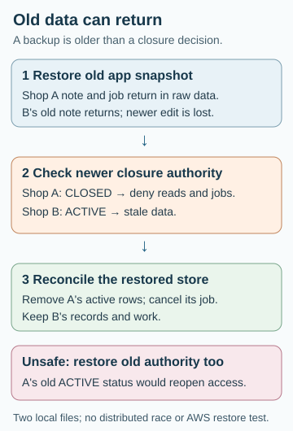

# A10 tenant offboarding: close the front door and count the remaining copies

Shop A leaves Maya's shared booking portal. It has a private note called `same-id`; Shop B has a different note with that same ID. A worker has a queued Shop A job. Before closing Shop A, predict what each read and job should do afterward. Then run this standard-library lab from the repository root:

```sh
python3 examples/tenant-offboarding/lab.py
python3 -m unittest discover -s examples/tenant-offboarding -p 'test_*.py' -v
```

No AWS service or paid resource is used. The fixture creates one temporary SQLite file and removes it on exit. `alice`, `bob` and the two operators are public fixture strings, not authenticated people. The operator map is a teaching stand-in for a checked administrative permission.

## Read the result as a limited receipt

`CLOSED` blocks subsequent Shop A reads and new jobs. This is checked before using a warm cache. The local transaction cancels pending Shop A jobs, removes Shop A's active notes and records counts. Shop B's colliding note and job still work. Repeating the same authorized closure returns the first receipt instead of reporting a second removal. A completed Shop A job is counted for review; the fixture performs no external action, so it cannot establish whether a real email, payment or export happened.

| Receipt field | What was observed locally | What it does not prove |
| --- | --- | --- |
| `active_notes_removed` | Rows removed from this SQLite notes table | All copies or backups were erased |
| `pending_jobs_cancelled` | Rows still pending in this SQLite queue were marked cancelled | An already running external worker stopped |
| `already_completed_jobs_to_review` | Jobs marked done before closure | Their downstream effects were reversed |
| `outside_this_fixture` | Copy and effect categories requiring separate inventory | Their presence, absence or legal retention status |

An offboarding request has at least three clocks: **access stop**, **active-data cleanup**, and **retained-copy lifecycle**. A single `DELETE` statement cannot prove all three. In a real service, decide which records must be retained and for how long, verify backup/search/object-store behavior, account for in-flight work, and make the customer-visible status match the evidence. This packet supplies no legal retention rule.

## Restore yesterday's data after today's closure

Imagine Shop A closes today, but tomorrow an operator restores yesterday's shared database to recover Shop B's records. Yesterday's backup still contains Shop A's note and queued job. A restore can bring those raw rows back without making Shop A an authorized customer again.

Before running the second local exercise, predict four observations: a raw query of the restored data, a guarded Shop A read, a guarded Shop A job, and a Shop B read. Then predict what happens if the **closure authority itself** is also restored from yesterday's copy.

```sh
python3 examples/tenant-offboarding/restore_boundary.py
python3 -m unittest discover -s examples/tenant-offboarding -p 'test_*.py' -v
```

The script makes two disposable SQLite files. One holds active notes and jobs; the other holds the later Shop A closure decision. It takes old snapshots of both, then gives Shop B a newer note and closes Shop A. Restoring only the old app file brings back Shop A's note and pending job **and loses Shop B's newer note**. Methods that check the separately preserved closure decision deny Shop A while Shop B remains authorized, but its visible value is stale. A reconciliation pass removes the resurrected Shop A note and cancels its pending job; it cannot reconstruct Shop B's lost newer value. Five focused changed-case tests also show that an unavailable closure authority fails closed and that restoring its **old** `ACTIVE` value too would unsafely reopen Shop A. The latter is a negative control, never an approved recovery step.



This fixture is sequential. The check and data read live in separate files and transactions; a concurrent closure could race between them. A real design needs an authoritative access gate with a tested ordering or epoch, protected retention of closure decisions, restore ordering, job and cache handling, copy inventory, legal retention decisions and customer-visible evidence. The lab proves none of those AWS or multi-worker properties. It also does not erase backup bytes. Ask Codex to propose a restore runbook, then make it identify the exact point where the app may begin serving requests and the evidence needed before claiming Shop A remains closed.

## Put closure between the check and the read

A door guard checks Shop A's pass. The pass is revoked a moment later, but the guard has already waved Alice through. The separate-file restore fixture has this opening: it checks closure authority, then reads the note in another transaction. Run the controlled interleaving:

```sh
python3 examples/tenant-offboarding/closure_race.py
python3 -m unittest discover -s examples/tenant-offboarding -p 'test_*.py' -v
```

The intentionally unsafe path reads `ACTIVE` from one SQLite file, changes it to `CLOSED`, then still returns Shop A's note from the other file. This is an observable stale-decision leak in the fixture. The comparison places authority and note in one SQLite file. Its reader starts `BEGIN IMMEDIATE`, checks `ACTIVE`, attempts a closure from a second connection and observes SQLite refuse that concurrent write while the read transaction is open. The read finishes first. After the closure commits, the next read is denied. The two operations now have an observable local order: **read before closure** or **closure before denied read**. A customer promise must specify which in-flight work is allowed to finish at the closure boundary.

`BEGIN IMMEDIATE` takes a database write reservation even for this read. It is a simple teaching control with concurrency and throughput costs, not a production recommendation for every read. It also cannot make another service's cache, worker, provider or restored file share the transaction. A distributed design needs a selected authority, linearization/fencing rule and tests on every route. Ask Codex to find a route that would bypass the one-file transaction, then name the measurement that would distinguish a safe denial from a stale permitted read. Check its answer against this run before extrapolating to AWS.

## Changed cases to solve before the assessor

1. The cache contains Shop A's note before closure. Which check must still run on the next read? Why is merely evicting this process's cache insufficient for a fleet?
2. The queued job is pending at closure. Now change the case: another worker already completed its database job but may have sent an email. Which receipt field changes, and what investigation remains?
3. Shop B uses the same record ID. Which key and predicate keep its record available when Shop A closes? What would fail if deletion used only `id='same-id'`?
4. An operator assigned to Shop B asks to close Shop A. Identify the denial in this fixture and the stronger identity/authorization proof a cloud system needs.
5. A backup taken before closure is retained under a reviewed policy. Can the receipt say “all data erased”? Write a narrower statement and a future verification step.
6. Shop A asks to return after closure. Should the old receipt and job IDs disappear? Explain what must be decided before reusing the tenant identifier.
7. Yesterday's app snapshot is restored after today's Shop A closure and Shop B update. Which independent decision must survive? What if the closure ledger is unavailable, or both files are restored to yesterday? Can Shop B be called recovered merely because its read works? Write the status page sentence before and after reconciliation.
8. Closure occurs between an `ACTIVE` check and a note read. What does the split-file interleaving return? In the one-file control, which operation completes first, what does the next read return, and what price does `BEGIN IMMEDIATE` impose? Change the case to a warm cache or a separate worker and name the missing gate.

For an architecture review, compare (a) immediate access stop followed by an inventoried cleanup workflow and (b) a single synchronous deletion request. The second may look simpler to a caller, but it cannot make distributed copies, in-flight effects and backup lifetimes atomic. State what the status page should say during cleanup and what evidence permits the final claim. Read [assessor reasoning](ASSESSOR.md) after answering.

Ask Codex to trace each tenant value from authenticated request to cache, query, job, restore and deletion predicate. Require it to find a counterexample to any broad “all data deleted” sentence. Check every claim against the fixture; its passing tests establish only the named local behavior. Before any AWS version, select the actual services and retention rules, verify current pricing and permissions, choose a conservative spending limit and reserve for your own account, and keep organization-dependent SaaS deployment as design work until its account and team prerequisites exist.
