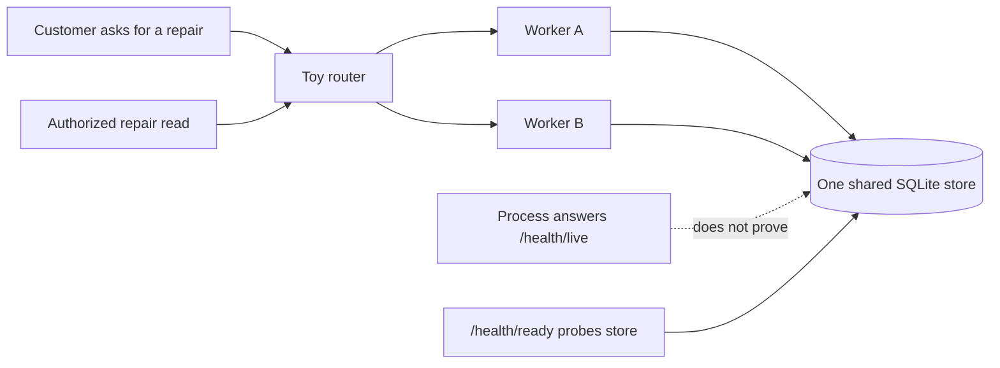

# A06 two workers and one data store

Maya adds a second application worker so one unhealthy worker need not stop the repair service. The browser still needs to find a repair regardless of which worker receives the next request. The [Unit 02 lesson](../../reader/BOOK-LOCATORS.md#book-09b38b14b7e44189) and [diagram](../../book/figures/three-tier-shared-state.svg) show the boundary before you run the lab. Write predictions before reading the [assessor notes](ASSESSOR.md).

From the repository root run `python3 examples/three-tier-boundary/lab.py`, then `python3 -m unittest discover -s examples/three-tier-boundary -p 'test_*.py' -v`. Python's standard library supplies loopback HTTP and SQLite. The fixture binds only to `127.0.0.1` on an ephemeral port, uses public actor strings and a temporary database, and removes it on exit. It requires no AWS login, packages, Docker or paid service.

## Predict the observable path

| Change | Predict the result before running |
| --- | --- |
| Alice submits a repair through worker A; the next request reaches B | Will B's private memory find it? Will the shared database find it? |
| Bob asks for Alice's repair ID | Should the response expose Alice's record or its existence? |
| One worker is unhealthy | Where should the toy router send a request? |
| Both workers are marked unhealthy | What does **this toy router** return? Would AWS ALB necessarily behave the same way? |
| The single fixture database slot is held while both workers are healthy | Does another application worker create a database slot? |
| The shared store becomes unavailable while one worker still runs | Which response can still be 200? Can a customer retrieve the repair? |

The lab uses a `POST /repairs` path, a correct `GET /repairs/{id}` path and an intentionally defective `GET /local/{id}` path. The latter consults one worker's private dictionary. Its failure is the lesson, not a recommended API. The synthetic `Authorization: Bearer fixture-alice` and `fixture-bob` strings are public test labels, not authentication. The fixed one-slot semaphore models a finite shared dependency; it does not model RDS connection counts, SQL throughput, RDS Proxy or ALB's routing algorithm. The two workers are Python objects in one process, not EC2 instances or Availability Zones. The outage switch refuses **new fixture connections**; it does not interrupt an in-flight SQL operation.

The seven focused tests make HTTP requests to the loopback server. They check a cross-worker successful read, a forbidden read that looks like an absent ID to the caller, a busy shared store, a routed healthy worker, a rejected invalid submission, and the shared-store outage/readiness path. The database row can survive a worker change because it is stored in the shared SQLite file. This says nothing about real database failover, recovery time, multi-process transaction isolation or cloud IAM.

## When the web worker lives but the repair does not

Imagine Maya calling the repair shop. The receptionist answers the telephone, but the repair ledger is locked in another room. “I answered” is true; “I can tell you about your repair” is false. The lab makes that difference visible with two toy health paths. `GET /health/live` says only that the loopback server process can answer. `GET /health/ready` makes a shallow local store probe and returns 503 when the fixture store is unavailable or its one slot is busy. Neither probe proves that Alice can read her repair; the separate `GET /repairs/{id}` is the customer-level check.

Run the lab and find `store_outage_live_ready_customer: [200, 503, 503]`. Both app workers still exist, but a previously accepted repair cannot be read while the shared store is switched off. The scenario then switches the fixture store back on and reads the same repair successfully. This checks **availability of an existing customer record after the simulated interruption**. It does not show data restoration, an independently failed database process, automatic failover or a measured recovery interval.

**Change the case before reading the assessor:** The process health path is green; both workers are green; the readiness path is red; Alice's repair read returns 503. Decide whether to add another worker, route to the other worker, restore store access, or stop accepting work. Name the first observation that could disprove your diagnosis. Then imagine `SELECT 1` succeeds but Alice's repair is missing or the store returns the wrong tenant's record: which extra business check is needed? Ask Codex to propose a diagnosis, then require it to distinguish observed HTTP results from its untested AWS suggestions.

## Transfer to the AWS design

For A06, compare two bounded options: (1) keep one continuously running application worker and accept its outage/rebuild window, or (2) use a load-balanced EC2 Auto Scaling group across failure locations with a shared relational store. The second option buys a possible worker-failure path but adds load-balancer and spare-capacity cost, release/health-check work and a database dependency. Select only after stating response, availability, recovery and budget needs. A worker-local repair or login state is a hidden dependency in option 2; move authoritative state to an appropriate shared, protected store or redesign the workflow.

AWS Application Load Balancer target groups route to registered targets and use health checks; the Auto Scaling group must also be configured to use ELB health information if it is expected to replace load-balancer-unhealthy instances. Critically, AWS documents that an ALB with **only unhealthy registered targets can fail open** and still route to them. The toy router deliberately returns `503` in that case, so never cite its all-unhealthy result as proof of ALB behavior. [ALB target-group guidance](https://docs.aws.amazon.com/elasticloadbalancing/latest/application/load-balancer-target-groups.html), [health-check fail-open behavior](https://docs.aws.amazon.com/elasticloadbalancing/latest/application/target-group-health-checks.html), [Auto Scaling health checks](https://docs.aws.amazon.com/autoscaling/ec2/userguide/health-checks-overview.html).

If the relational database reaches its connection or work limit, adding application workers can worsen pressure. RDS Proxy is one possible connection-management candidate, but it does not remove SQL work and session pinning can reduce reuse. Verify engine support and the actual workload before including it. [RDS Proxy concepts](https://docs.aws.amazon.com/AmazonRDS/latest/UserGuide/rds-proxy.howitworks.html), [pinning behavior](https://docs.aws.amazon.com/AmazonRDS/latest/UserGuide/rds-proxy-pinning.html). The existing [connection cleanup drill](../connection-pool/README.md) tests a separate local transaction boundary.

Estimate the selected Region's EC2 runtime and attached storage, load-balancer hours/capacity, database/proxy, data transfer, logs, backups and idle standby from current official price pages before any authorized live trial. Choose whole-run spending and reserve limits for the account you will use. [EC2 pricing](https://aws.amazon.com/ec2/pricing/), [ELB pricing](https://aws.amazon.com/elasticloadbalancing/pricing/), [RDS pricing](https://aws.amazon.com/rds/pricing/). This lab makes no price or spend claim.

**Change the case:** Maya opens a second repair branch. One branch loses its app worker during peak time, then the database becomes unavailable. Draw which customer operations can still work and which must stop. State the signal that distinguishes a worker problem from a shared-store problem; how you would prevent a misleading green health check; and what would count as useful recovery, including an authorized customer read. Ask Codex to challenge the option you chose with an all-unhealthy target group and a database saturation case. Require current AWS source links, and label model suggestions separately from your tested local result and untested cloud behavior.
