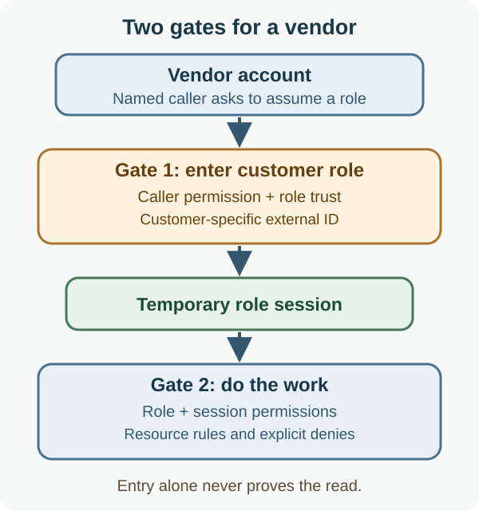

# A vendor badge has two gates

Maya hires Beacon to inspect repair-case exports. Beacon serves many customers. Cedar, Maya's fictional AWS account, owns one private object containing a daily case summary. Another customer asks Beacon to use Cedar's role ARN by mistake—or on purpose. A role ARN is an address, not proof that the request belongs to Cedar.

This is a **paper architecture lab**. Cedar, Beacon and the object are invented. No policy is deployable here, no IAM authorization engine is simulated, and no AWS call is needed. Read the [identity chapter](../../reader/BOOK-LOCATORS.md#book-2556b725756e00e1), decide each card below, then compare the [assessor](ASSESSOR.md). Keep the answer distinct from a live access claim.

## The agreed rule cards

- Cedar's role trusts Beacon's account **only when** `sts:ExternalId` matches the customer-specific value Beacon assigned to Cedar. Beacon's intended caller has an identity permission for `sts:AssumeRole` on Cedar's role. Assume no other path grants assumption.
- The role's identity policy allows `s3:GetObject` on exactly one existing Cedar object. No other object action is granted. A session policy, when a card supplies one, limits the role; it cannot add an action.
- For cards 1–5, assume the named object's resource rules permit this role session, there is no KMS dependency, no applicable explicit deny and no unstated organization, endpoint or service restriction. These artificial exclusions make the paper decisions answerable. A real review must collect those inputs.
- The question **“can enter?”** concerns `sts:AssumeRole`. **“Can read?”** concerns a later `s3:GetObject` request using the resulting temporary credentials. If entry fails, the later read through this role does not occur.

## Decide before reading the assessor

For each card, record **entry: yes/no/unknown**, **object read: yes/no/unknown**, the gate that decides it, and a safe observation that would test the design. Do not turn a paper yes into “AWS verified.”

1. **Expected customer.** Beacon's named caller asks for Cedar's role using Cedar's assigned external ID. No session policy is supplied. It then requests the exact object.
2. **Wrong customer value.** The same caller uses another customer's external ID. Everything else is unchanged.
3. **Missing caller permission.** Cedar's trust and external ID match, but Beacon removed this caller's `sts:AssumeRole` grant.
4. **Narrowed session.** Entry succeeds. Beacon supplies a session policy allowing only `s3:ListBucket`, then asks for `s3:GetObject`. Can the role's wider identity grant restore the read? Would the session policy alone grant listing if the role identity policy omitted it?
5. **Wrong object.** Entry succeeds without a session policy; Beacon requests an existing object outside the role's single-object grant. Assume no separate resource-policy grant.
6. **Resource-side stop.** Start with card 1, but add an applicable explicit deny on the requested object for this session. Is entry still possible? What happens to the read?
7. **Shared customer identifier.** Beacon accidentally assigned the **same** external ID to Cedar and another customer, and its integration accepts an arbitrary customer role ARN with no tenant-to-role binding. A user of the other customer knows Cedar's role ARN and asks Beacon to run the job against it. Identify the failed tenant-binding control. Does the mere existence of a shared ID prove a real unauthorized read, or what else must be observed?
8. **Different architecture.** Beacon keeps its own caller credentials and requests Cedar's object directly using a Cedar bucket policy, without assuming a Cedar role. Which two account-side grants would need review? Why would the role's external-ID trust condition not govern this direct route?

For cards 7–8, mark the final access result **unknown** unless all required policies, target conditions and actual request behavior have been supplied. These are threat and design questions, not an invitation to try another customer's role.

## Turn the exercise into an operating decision

Choose a customer-specific external ID assigned by Beacon, restrict the vendor caller and Cedar role to their named jobs, and bind Beacon's tenant record to Cedar's approved role ARN. Record who can change that binding and who can approve a new one. The external ID addresses a confused-deputy path; [AWS says it is not a secret](https://docs.aws.amazon.com/IAM/latest/UserGuide/id_roles_common-scenarios_third-party.html). It does not replace either side's permissions or target-resource controls. A role is useful because its credentials are temporary; that does not make an overly broad session harmless.

For a real, separately approved implementation, request a readback of the installed trust and permission versions, the vendor's caller grant and tenant binding, the actual role-session identity, the object policy and any key, network or organization restrictions. Use a disposable, nonsensitive fixture for a meaningful allowed read and a meaningful denied read, and distinguish authorization denial from a missing object or malformed request. Record the time, caller, action, resource and result. Do not test by reading another customer's actual data. The vendor's use of Cedar resources can be billed to Cedar; estimate the full run and cleanup before any account experiment. This exercise does not provision a second account or Organization.

Ask Codex to produce a two-column trace for each card: **evidence supplied** and **evidence still missing**. Require it to explain the two gates and to challenge any claim that an external ID is a password or that passing role trust proves an object read. Verify its IAM claims against the [AWS cross-account evaluation guide](https://docs.aws.amazon.com/IAM/latest/UserGuide/reference_policies_evaluation-logic-cross-account.html), [third-party role guide](https://docs.aws.amazon.com/IAM/latest/UserGuide/id_roles_common-scenarios_third-party.html) and [session-policy guide](https://docs.aws.amazon.com/IAM/latest/UserGuide/access_policies.html#policies_session). AI critique is not an IAM test or learner assessment.
