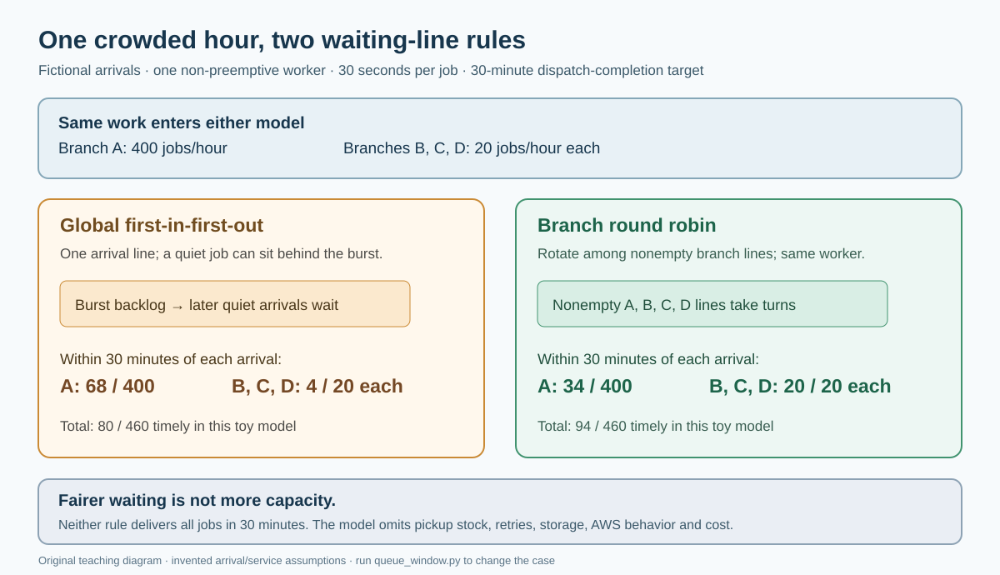
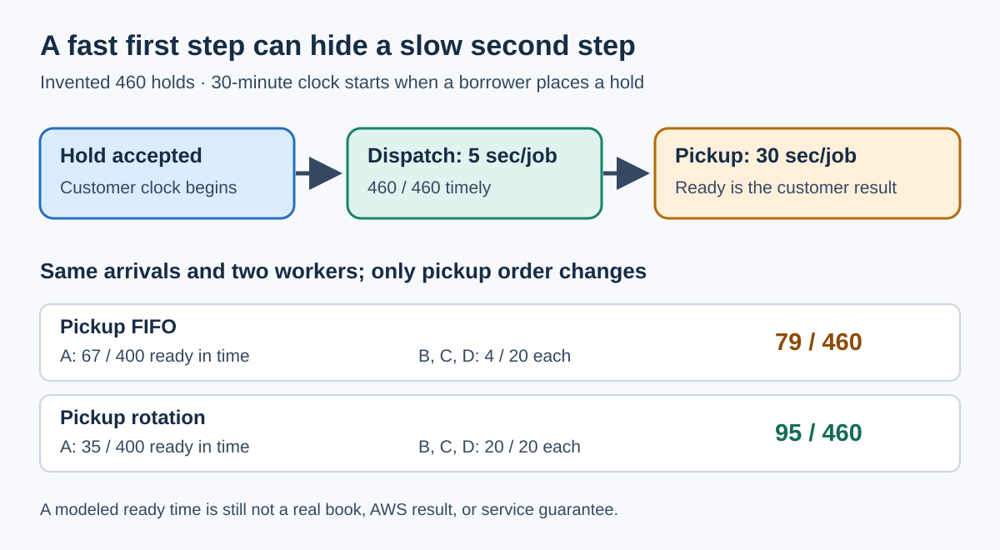

# A branch library changes the architecture review

This is a fictional, cloud-free decision exercise. Read [the six-angle lesson](../../reader/BOOK-LOCATORS.md#book-c0fb4ecf2653015f) and save your first answer before opening the [facilitator notes](ASSESSOR.md). You need no AWS account, prices or code installation. The diagram is an original teaching aid, not a claim that the workload has passed an AWS Well-Architected review.

## The first decision

Four library branches let borrowers place a hold on a book. The system must acknowledge a hold only after saving it durably. A borrower may see their own holds but may not read or change another borrower's holds by guessing an ID or file link. Staff may see their branch's pickup list. A requested pickup must be ready or honestly refused within 30 minutes. At present, a branch averages 20 requests per hour; the busiest 15-minute interval, retention rule, restore target, staff-hours budget and AWS prices are unknown. The library has two operators.

Compare two *candidates* under those facts:

- **A: shared path.** One request service, one work queue and one data store hold all branches' work, with borrower and branch scope enforced at every read, write, worker and report.
- **B: selected branch boundaries.** The front door and identity remain shared, but each branch has its own queue and hold store. Staff still need branch-scoped access; shared identity and publishing paths remain common dependencies.

Draw each candidate from borrower request to pickup result. Mark where a durable receipt is created, where authorization is checked, what happens after a lost reply, and which component makes a pickup ready. For **each of the six review angles**, name one question, the supplied evidence, what remains unknown, and a test or business decision needed before adoption. Do not replace an unknown with a guessed service limit or price.

Choose one candidate **provisionally**. Give one advantage and one risk for each. Name the observed result that would reject your choice. Record who would decide the 30-minute promise, retention and restore target. A diagram of the proposed path is design evidence; it does not establish a deployed denial, capacity or cost result.

## Make the noisy branch visible before choosing a boundary

Imagine one library clerk working through a pile of hold slips. Changing the order of slips can help a quiet branch, but it cannot make the clerk finish more slips per hour. Run this **invented dispatch model** from the repository root:

```bash
python3 examples/well-architected-review/queue_window.py
python3 examples/well-architected-review/queue_window.py --shape front-loaded
python3 examples/well-architected-review/queue_window.py --seconds-per-job 5
python3 -m unittest discover -s examples/well-architected-review -p 'test_*.py' -v
```

The default model gives A 400 jobs and B, C and D 20 each over an hour. It assumes **one** non-preemptive worker, exactly 30 seconds of work per job, an even arrival pattern and a 30-minute deadline measured from each job's arrival to the model's dispatch completion. That worker can do 120 jobs in a fully busy hour, while 460 arrive. The model does not fetch a book, notify a borrower, retry a failure or spend AWS money.



| Fictional rule | A finished within 30 minutes | Each quiet branch finished within 30 minutes | What the result actually shows |
| --- | ---: | ---: | --- |
| One global arrival line | 68/400 | 4/20 | The burst can raise wait for everyone. |
| Rotate among nonempty branch lines | 34/400 | 20/20 | Quiet branches improve, but A loses more deadlines. |

Both rules process **the same 460 jobs with the same worker and service time**. Rotation changes *who waits*, not the amount of work. The front-loaded change card keeps the same hourly totals but sends A's 400 in the first 15 minutes; B's timely count under the global line falls from four to one. At an invented five seconds per job, all 460 finish within 30 minutes under either rule. The first two comparisons show why a one-hour average does not reveal the busy interval or establish a capacity answer; the last changes the assumed worker speed and must not be reported as an AWS benchmark.

Before opening the [facilitator notes](ASSESSOR.md), answer three questions: Which customer group gains or loses under each rule? Could candidate A use a trusted branch label and fairness policy without adopting candidate B's separate stores? What measurement of **accepted hold to honest pickup result** would reject your provisional choice even if queue wait looked good? Record your first answer and one changed-case revision separately. The [A10 toy scheduler](../tenant-fairness/README.md) introduces fairness with five jobs; this case adds a declared arrival shape, a deadline, unchanged worker capacity and a visible tradeoff.

## Follow the hold all the way to ready

Suppose the library speeds up dispatch to **five seconds per hold**. Every one of the 460 fictional holds now leaves that first step within 30 minutes. A borrower still cannot pick up a book merely because a slip reached the pickup desk. Give that desk its own single worker who needs **30 seconds per hold**, and keep the same 30-minute clock starting when the borrower placed the hold:

```bash
python3 examples/well-architected-review/pickup_window.py
python3 examples/well-architected-review/pickup_window.py --pickup-policy round-robin
python3 examples/well-architected-review/pickup_window.py --pickup-seconds 5
```



With pickup in arrival order, only **79 of 460** are ready within 30 minutes: A has 67/400 and B, C and D each have 4/20. Rotating *pickup* work among branches changes the outcome to **95 of 460**: A has 35/400 and the three quiet branches each have 20/20. The dispatch worker was already fast in both runs. The second worker is the bottleneck, and rotation still changes who waits instead of adding capacity. The optional five-second pickup change deliberately changes that capacity assumption; inspect its output before claiming that all borrowers are served.

The model connects each job ID through both stages and measures arrival-to-ready, not dispatch-to-ready. It assumes each stage has one non-preemptive worker, deterministic work times and no walking, shelf search, missing book, notification, retry, failure or staff shift. Neither the two-stage arithmetic nor the word *ready* proves a physical book is available. Before opening the assessor, write which stage you would measure at a real library, what evidence would show a genuinely ready pickup, and which branch loses when pickup rotation helps the others. Ask Codex to challenge your answer with one omitted step, then check its suggestion against the stated process and keep your first answer intact.

AWS documents [SQS fair queues for standard queues](https://docs.aws.amazon.com/AWSSimpleQueueService/latest/SQSDeveloperGuide/sqs-fair-queues.html): a producer supplies a tenant `MessageGroupId` and SQS may prioritize quiet groups when one group dominates work. That is **not this round-robin algorithm**, a per-branch quota, FIFO ordering or a completion guarantee. The application must derive the branch label from trusted membership, then verify allowed and forbidden reads independently. A standard queue's grouping is not a substitute for the stricter ordering meaning of a [FIFO queue's message group](https://docs.aws.amazon.com/AWSSimpleQueueService/latest/SQSDeveloperGuide/using-messagegroupid-property.html). The [existing SQS design packet](../tenant-fairness/SQS-DECISIONS.md) explores those service-specific choices. A later AWS run would need current availability, permissions, complete rates, a selected customer-path test, an account-owner-chosen whole-run estimate limit and credit reserve, and cleanup. This local model uses no account or credit.

## The change card

During one event, one branch receives **400 requests in one hour** while the other three remain at their previous average. The event coordinator also asks that last year's borrower hold files remain available for a year, but the privacy owner has not approved any retention period. An operator proposes adding ten workers to the shared queue and keeping every file indefinitely “to be safe.” No workload measurement or price is supplied.

Preserve your first answer. Explain what this changes for the 30-minute customer promise, cross-branch fairness, the private-file boundary, operating visibility, recovery and the whole-path cost. Would ten workers or indefinite retention solve either problem on the evidence supplied? Compare A and B again, including the extra lifecycle work of B and the possible contention of A. State a bounded first measurement or local test, its stop condition, and which decision remains with the privacy owner. Distinguish a smaller byte count from a measured sustainability impact.

## Separate the AI-assisted pass

After saving your independent work, ask Codex: “Which one missing fact could reverse my choice between A and B? Point to the part of my answer that depends on it. Do not invent a price or test result.” Save the prompt, response, your revision and your reason for accepting or rejecting its suggestion. Mark what Codex supplied; an assisted correction is a different result from your first explanation.

For a real follow-up, refresh the [AWS Well-Architected six pillars](https://docs.aws.amazon.com/wellarchitected/latest/framework/the-pillars-of-the-framework.html) and any applicable lens against the selected architecture. A full formal review would assess the relevant questions and best practices, record actual workload evidence and track improvements. This exercise samples one original question per pillar and cannot be scored as a complete framework review. An authorized live trial would separately require current identity, service support, a complete estimate within the account owner's chosen limit, a verified credit reserve chosen for that account, bounded execution, cleanup and later billing reconciliation.
