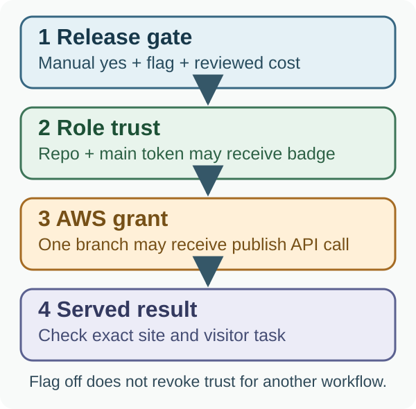

# The release switch and the job badge: an evidence case

Imagine that a workshop has a switch marked **Open the front door** and a badge that lets a worker enter the supply room. Turning the front-door switch off does not revoke the worker's badge. A GitHub publication variable and an AWS role have the same kind of separation: the variable controls jobs that check it; the role's trust and permissions control an AWS session.

This case comes from the author's private October 23, 2026 lab record. The underlying repository and run log are private. The summary below is an authored teaching extract, **not** a public log a reader can independently inspect. Use it to practice classifying evidence; do not infer the account's current configuration from a dated observation.

## What the bounded probe showed

A manually started GitHub Actions workflow on the trusted `main` branch requested an OIDC token and assumed the lab's publisher role. In that short session, its assertions for STS identity, the AWS Free-plan read and one named AWS Budget read succeeded. The checked workflow source made no Amplify deployment call. The separate publication workflow's `AMPLIFY_PUBLISH_ENABLED` variable was false. This was a read-only identity probe, not a publication.

| Claim | Evidence in this case | What it does **not** establish |
| --- | --- | --- |
| A second trusted-branch workflow assumed the role | The dated GitHub run and its STS assertion succeeded in the owner's record | That every workflow or branch can assume it |
| That session completed two account reads | The Free-plan and named-budget assertions succeeded | The current balance, a future bill or the ability to publish |
| The publication workflow did not run in this probe | Its own run listing was empty at the recorded check and its variable was false | That another workflow cannot request the same role |
| An Amplify release would work | **No observation**: the probe made no Amplify call | A deployed revision, served page or customer result |

At the time of this probe, the installed role trust checked the token audience and a specific repository-and-branch subject. It did not check the workflow filename or the publication variable. A second workflow on that trusted branch could therefore request the role if it had token permission; whether an AWS action succeeded still depended on the role's effective permissions and other controls. A later Terraform source candidate adds a workflow-**name** condition, but this receipt does not show that condition applied. The successful probe demonstrates **one real role assumption and two reads**, within its date and scope. It did not test an unrelated-target denial or `CreateDeployment`.

## Try the decision before reading the answer

1. A documentation commit lands on `main` while the publication variable is false. The checked publication workflow is manual only. Does the commit itself publish?
2. A different workflow on the trusted branch requests an OIDC token while the publication variable remains false. Can that variable alone prevent role assumption?
3. The role session succeeds, but the build has no approved cost record. Can the team claim a visitor saw a new page?
4. Someone turns the variable off after a publish job has begun. What must they inspect or stop, and what hosted resources might remain?

**Reasoning check.** The first commit does not start the manual workflow. The second workflow is outside that workflow's variable gate; role trust and effective permissions must be evaluated separately, and the dated probe demonstrates that the second path worked for two reads. A role session does not prove a build, deployment or browser result. A variable change does not cancel an in-flight job or delete hosted bytes and backend resources. Inspect the exact run and resource inventory; use a separately authorized, cost-reviewed test before making stronger claims.

## A small cloud-free check

Read the checked-in [probe workflow](../examples/github-workflows/probe-amplify-publisher-identity.yml), [publication workflow](../examples/github-workflows/amplify-publish.yml) and [OIDC trust model](../examples/oidc-trust-boundary/README.md). Predict which file requests an OIDC token, which jobs inspect the publication variable, and which condition is enforced by AWS trust. Then run only the local trust model as its README directs. Its fictional token cases can falsify an overbroad explanation of the source; they cannot reproduce the dated GitHub session or verify a live AWS policy.

Ask Codex to make a five-column claim ledger: **source**, **local model**, **IAM simulation**, **observed cloud session**, **customer result**. Have it place each of the four cases above in the narrowest supported column, then challenge it with a second workflow and a changed branch. Check the actual workflow and trust files yourself. An AI answer is a study aid, not an account receipt.

For the longer exercise, try [E28](../curriculum/EXERCISES.md#e28) and compare with its [assessor](../examples/frontend-publisher/OIDC-ASSESSOR.md). This case supplies the probe facts needed for that exercise without distributing the owner's account receipt.
