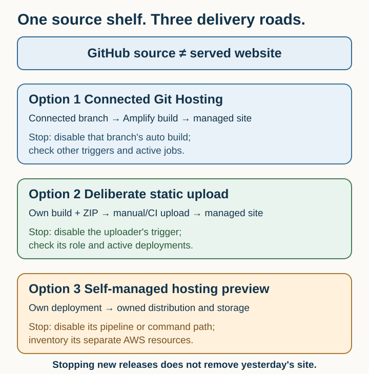

# From a GitHub change to an Amplify website

Maya writes a repair guide and saves it in GitHub. That is like putting a new drawing on the workshop shelf. A visitor does not see it until someone builds the site, delivers the built files and checks the storefront. The **source**, **build**, **deployment** and **served result** are four different things.

## Choose the road that matches the job

| Road | Who builds and hosts? | What starts a release? | First stop control |
| --- | --- | --- | --- |
| **Connected Amplify Git branch** | Amplify builds the connected branch and serves it through managed Hosting | A connected-branch commit when automatic builds are enabled, or another configured build trigger | Disable auto build for that branch, then inspect any other trigger and running build |
| **Manual static upload** | Your own build makes a ZIP; Amplify Hosting serves its uploaded static files | A deliberate console/API upload or a CI job you built to do it | Stop that uploader or job and inspect active deployments and credentials |
| **Self-managed hosting preview** | Your project defines and owns the generated hosting stack, including its distribution and storage | The chosen `ampx deploy` command or a separately configured pipeline | Stop that pipeline or command path and inspect its AWS resources |

AWS documents [branch auto-build controls](https://docs.aws.amazon.com/amplify/latest/userguide/edit-build-settings.html), [manual deployments without a Git provider](https://docs.aws.amazon.com/amplify/latest/userguide/manual-deploys.html) and [self-managed hosting](https://docs.amplify.aws/react/deploy-and-host/self-hosting/getting-started/) as separate paths. Manual Amplify Hosting deployments do not support server-rendered apps; a static ZIP is not a substitute for SSR compute. AWS marks self-managed hosting as a **preview** and says it is not recommended for production workloads yet. Its `ampx deploy` command can deploy backend and hosting stacks, while `--frontend` narrows that command to the frontend for an already deployed backend. These product rules should be rechecked in current AWS documentation before a real choice.

GitHub does not choose Amplify for every repository. You select a repository and branch when connecting managed Git Hosting, or you explicitly give a CI workflow an upload path. A separate repository can have a different destination. Connecting source also does not automatically authorize a private customer-data request; the app's Auth, Data and API permissions need their own design and tests.

## Stop the right thing

Maya turns off the delivery truck. The last sign is still hanging on the storefront, and the stockroom still exists. The same distinction matters here:

1. **Stop new releases.** Disable the specific branch auto build or CI trigger. Check manual triggers, other workflows, webhooks and jobs already running. A repository variable only controls jobs that read it.
2. **Stop new AWS access if needed.** Review the role trust and grants used by the delivery path, plus any already issued session. Turning off a workflow's variable does not itself change AWS role trust. The [badge evidence case](GITHUB-PUBLISHER-EVIDENCE-CASE.md) shows this separation.
3. **Remove what should end.** Inventory the hosted branch or distribution, backend resources, storage, logs, alarms and retained copies by owner. Remove the selected resources with their actual infrastructure owner, verify the inventory afterward and check billing later. Stopping releases is not resource deletion.

The costs also follow the chosen road. Managed Git builds, manual CI, Hosting delivery, backend calls, logs and retained resources can belong to different meters or providers. Self-managed hosting introduces its own generated-resource inventory. Before an authorized live test, use the [cost-and-credit field lesson](COST-AND-CREDIT-FIELD-LESSON.md) to estimate the **whole** run, set a stop plan and check the current account's terms. An estimate and a budget alert are useful evidence and controls, but neither is a hard universal spending cap.

## Practice without a cloud account

**Predict.** Maya pushes a new guide while a connected branch's auto build is disabled. Which system has the new source? What evidence would show that visitors got a new page?

**Change the road.** She adds a separate GitHub Actions workflow that uploads a static ZIP on manual dispatch. Does the branch auto-build switch stop that workflow? What would change if the site needs customer-specific HTML in its *first* response?

**Stop and inspect.** The manual workflow is disabled after yesterday's successful deployment. Which site and backend resources may still exist? What record would show that they were removed?

**Reasoning check.** The push updates GitHub. A disabled branch auto build does not start that branch's normal build, but you must inspect other configured triggers and the actual deployment history. A separate uploader has its own trigger and role; the branch switch does not govern it. Manual static upload cannot supply the required SSR behavior. Disabling tomorrow's job leaves yesterday's hosted result and any backend until their owners remove them. A successful build or upload still needs an exact served-page and customer-path observation.

Use the [fictional publication-boundary packets](../examples/publication-boundaries/README.md) and [hosting-road cases](../examples/amplify-hosting-modes/README.md) for changed situations. Ask Codex to draw a table of **trigger, builder, AWS identity, hosted resource, cost meter and stop control** for each road; then check every proposed control against the actual source and current AWS docs. Its answer cannot inspect your account, prove a customer result or decide that an experimental cost is acceptable.
